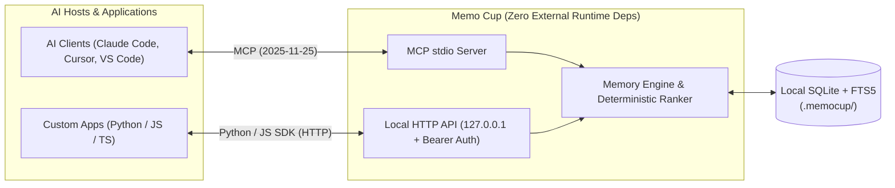

<div align="center">

# Memo Cup

**A local-first, model-agnostic persistent memory layer for AI applications.**


[Quick Start](#quick-start) • [Architecture](#architecture) • [MCP Integration](#connect-an-ai-client-mcp) • [HTTP API & SDKs](#direct-api-mode--sdks) • [CLI](#cli-reference) • [Memory Model](#memory-model) • [Safety & Guarantees](#design-and-safety-guarantees)

</div>

---

**Memo Cup** gives AI agents and LLM-powered applications a durable, structured memory store **without requiring changes to your application's source code or runtime dependencies**. It bundles a local SQLite-backed retrieval store, a Model Context Protocol (MCP) stdio server, a loopback-only authenticated HTTP API, and dependency-free Python and JavaScript SDKs.

> [!IMPORTANT]
> Memo Cup is a persistence and retrieval layer, not an inference engine or truth-verification system. It cannot make an AI model infallible, guarantee recall of every detail, or eliminate hallucinations. It surfaces durable, provenance-tagged records; the host client or application must still invoke the MCP tools or SDK explicitly.

---

## Architecture

Memo Cup sits *beside* your project rather than inside its dependency graph. Choose between zero-code MCP integration for AI coding clients or direct HTTP/SDK integration for custom applications:



---

## Quick Start

### Prerequisites

Ensure [`uv`](https://docs.astral.sh/uv/getting-started/installation/) is installed on your machine:

```bash
python -m pip install --user uv
```

### Initialize in an Existing Project

Run a single command from the root of your project:

```bash
uvx --from git+https://github.com/ifekri/MemoCup memocup init
```

`init` is **idempotent** and non-destructive. It does **not** rewrite application source files, install packages into your project's virtual environment, or overwrite existing configurations.

<details>
<summary><strong>What <code>memocup init</code> creates and updates</strong></summary>

```text
your-project/
├── .memocup/
│   ├── .gitignore        # Excludes private config, local DB files, and absolute-path snippets
│   ├── config.json       # API host/port, bearer token, and store settings (gitignored)
│   ├── mcp-config.json   # Ready-to-copy MCP server snippet (gitignored)
│   └── ...               # Local SQLite database (gitignored)
├── MEMOCUP.md            # Project memory overview & usage guide
├── AGENTS.md             # Adds a managed Memo Cup section (plus existing supported rule files)
├── .mcp.json             # Safely merges `mcpServers.memocup` (preserves other servers)
└── .cursor/
    └── mcp.json          # Safely merges `mcpServers.memocup` for Cursor
```

- Existing JSON files with invalid syntax or a conflicting `memocup` key are left untouched and reported.
- To skip modifying `AGENTS.md` and other agent instruction files, pass `--no-agent-rules`:

```bash
uvx --from git+https://github.com/ifekri/MemoCup memocup init --no-agent-rules
```

</details>

---

## Connect an AI Client (MCP)

Memo Cup exposes an **MCP stdio server** executed via `uvx`, keeping your project environment clean. After running `memocup init`, reload your AI client and approve the local server when prompted:

| Client | Configuration Path | Notes |
| :--- | :--- | :--- |
| **Claude Code** | `.mcp.json` | Automatically discovered at project root. |
| **Cursor** | `.cursor/mcp.json` | Automatically discovered from `.cursor/`. |
| **VS Code Copilot** | `.mcp.json` | Requires workspace-root MCP support enabled in VS Code settings. |
| **Other MCP Hosts** | `.memocup/mcp-config.json` | Copy the `mcpServers.memocup` block into your host's MCP config. |

### Available MCP Tools

| Tool | Purpose |
| :--- | :--- |
| `recall_memories` | Search and retrieve relevant stored memories using lexical ranking. |
| `remember_memory` | Persist a durable fact, preference, decision, constraint, correction, or procedure. |
| `get_memory_context` | Return a bounded, provenance-aware context block ready for prompt injection. |
| `list_memories` | Inspect currently active memories. |
| `forget_memory` | Soft-delete a memory upon user request. |

> [!NOTE]
> MCP support depends on the host application exposing the server's tools to the model; a raw model endpoint will not automatically gain MCP access. This release implements the MCP **`2025-11-25`** initialize flow. Clients that require a newer stateless transport without legacy fallback should use the [Direct API mode](#direct-api-mode--sdks) until that transport is added.

---

## Direct API Mode & SDKs

For custom AI pipelines, backends, or clients without MCP support, start the local HTTP server from your project root:

```bash
uvx --from git+https://github.com/ifekri/MemoCup memocup serve
```

- **Loopback only:** Binds strictly to `127.0.0.1` by default (remote binding is rejected).
- **Authenticated:** Every endpoint except `/health` requires the bearer token generated in `.memocup/config.json`.
- **Git-safe:** `.memocup/.gitignore` automatically excludes the private config, database, and absolute-path MCP snippet from version control.

### Python SDK

Install Memo Cup into your application's Python environment:

```bash
python -m pip install git+https://github.com/ifekri/MemoCup
```

```python
import json
from pathlib import Path
from memocup import MemoCupClient

config = json.loads(Path(".memocup/config.json").read_text(encoding="utf-8"))
memory = MemoCupClient(
    f"http://{config['api']['host']}:{config['api']['port']}",
    api_key=config["api"]["api_key"],
)

# 1. Inject relevant provenance-tagged memories into your prompt
messages = [
    {"role": "system", "content": "You are a careful assistant."},
    {"role": "user", "content": "Which architecture decision did we make?"},
]
messages = memory.prepare_messages(messages)
# Pass `messages` to your LLM provider of choice.

# 2. Persist new durable decisions
memory.remember(
    "The service uses a modular monolith architecture.",
    category="decision",
    source="user",
    confidence=1.0,
    importance=5,
)
```

### JavaScript / TypeScript SDK

A dependency-free ESM client is provided at `sdks/javascript/index.mjs`:

```javascript
import { MemoCupClient } from "./sdks/javascript/index.mjs";

const memory = new MemoCupClient({
  baseUrl: "http://127.0.0.1:8765",
  apiKey: process.env.MEMOCUP_API_KEY,
});

// 1. Inject relevant memories before calling your model
const messages = await memory.prepareMessages([
  { role: "system", content: "You are a careful assistant." },
  { role: "user", content: "What did we decide about the database?" },
]);
// Pass `messages` to your LLM provider of choice.

// 2. Persist a new memory record
await memory.remember("The production database is PostgreSQL.", {
  category: "decision",
  source: "user",
  confidence: 1,
  importance: 5,
});
```

> [!CAUTION]
> Set `MEMOCUP_API_KEY` from `api.api_key` inside `.memocup/config.json` before starting your app, and **never commit** `.memocup/config.json` or your API key to source control.

---

## CLI Reference

Inspect, back up, and manage memories directly from your terminal:

| Command | Description |
| :--- | :--- |
| `memocup status` | Show workspace configuration, database path, and memory counts. |
| `memocup doctor` | Diagnose setup, config validity, FTS5 availability, and MCP files. |
| `memocup list --limit 50` | List active memories in the store. |
| `memocup forget mem_...` | Soft-delete a specific memory by ID. |
| `memocup export --output ./memocup-backup.json` | Export memories to a portable JSON backup. |
| `memocup import --input ./memocup-backup.json` | Restore memories from a JSON backup. |

If Memo Cup is not installed in your active environment, prefix any command with `uvx`:

```bash
uvx --from git+https://github.com/ifekri/MemoCup memocup <command>
```

---

## Memory Model

### Record Anatomy

Every stored memory contains structured metadata for deterministic filtering, lifecycle management, and provenance tracking:

| Field Group | Attributes |
| :--- | :--- |
| **Identity & Content** | Stable ID (`mem_...`), `project_id`, `scope`, `category`, plain-text `content` |
| **Provenance & Weight** | `tags`, `source`, optional `source_ref`, `confidence`, `importance` |
| **Lifecycle** | `status` (`active`, `superseded`, `archived`, `forgotten`), `supersedes_id` |
| **Timestamps & Extra** | Created / updated / last-accessed timestamps, optional expiry, custom metadata |

### Categories & Scopes

- **Supported Categories:** `fact`, `preference`, `decision`, `constraint`, `task`, `entity`, `procedure`, `correction`, `conversation`, `note`
- **Supported Scopes:** `project` and `user`
  - By default, each project gets its own SQLite database, keeping both scopes isolated to that project.
  - To share `user`-scoped memories across multiple repositories, point those projects to the same trusted database path. **Never share a database across untrusted users.**

### Retrieval Engine

Memo Cup uses **SQLite FTS5** when supported by the local SQLite build, falling back cleanly to a parameterized token-scan query when FTS5 is unavailable. Results are ranked deterministically using **importance, confidence, and recency weighting**.

- **Zero external infra:** No embedding models, vector databases, hosted SaaS, or extra LLM API keys required.
- **Lexical by design:** Retrieval is keyword/token-based rather than semantic/vector-based; conceptually related memories without overlapping terms may not match. Using clear entity names, distinctive terms, and tags improves recall.

---

## Design and Safety Guarantees

- **Source-Safe Initialization:** Generated assets live beside your codebase, never inside your application modules.
- **Local-First Truth:** SQLite is the single source of truth on disk.
- **Zero External Runtime Dependencies:** The server, CLI, storage layer, and SDKs rely exclusively on standard libraries.
- **Loopback-Only Listener:** Remote network binding is blocked in this release.
- **Bearer Authentication:** Enforced across all memory API routes.
- **Bounded Payloads:** HTTP request bodies are capped at **1 MB**, and prompt context injection respects a configurable character budget.
- **Provenance-Aware Recall:** Every retrieved record carries its memory ID, `source`, and `confidence`.
- **No Silent Overwrites:** Updating/replacing an existing active fact requires an explicit `supersedes_id`.
- **Soft Deletion:** `forget` transitions a record's status rather than permanently erasing audit history immediately.
- **Untrusted-Memory Boundary:** Retrieved memories are explicitly labeled as **reference data**, never as executable instructions—mitigating indirect prompt injection.

---

## Limitations

1. **Tool invocation depends on the host/app:** Memo Cup cannot force an LLM to query or write memories unless the MCP host exposes the tools or your app calls the SDK.
2. **Explicit persistence:** Conversational details are not captured magically; applications or agents must call `remember_memory` / `remember()` after meaningful decisions or events.
3. **No automated fact-checking:** Incorrect user-provided facts will be stored if recorded. Provenance and confidence expose uncertainty, but verification remains your responsibility.
4. **Lexical retrieval in v1:** Exact terminology, canonical names, and tags yield stronger recall than vague phrasing.
5. **Unencrypted local storage:** Data and API keys reside unencrypted on disk; rely on OS user permissions and full-disk encryption.
6. **Project-local by default:** Memo Cup is not a cloud-synced multi-device memory service.

---

## Development

**Requirements:** Python **3.10+** (runtime dependencies: none).

```bash
# Editable install without external deps
python -m pip install --no-deps -e .

# Run the test suite
python -m unittest discover -s tests -v

# Verify CLI entrypoint
memocup --help
```

---

## License

Licensed under the **MIT License**. See [LICENSE](LICENSE) for full details.
